

  
  
  

  
   
  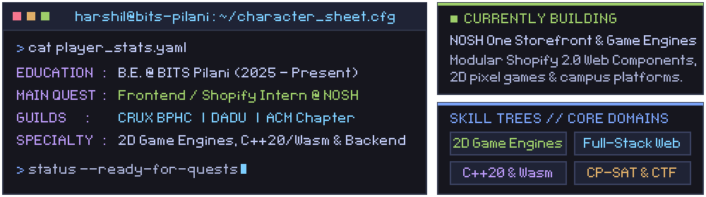

  
   
  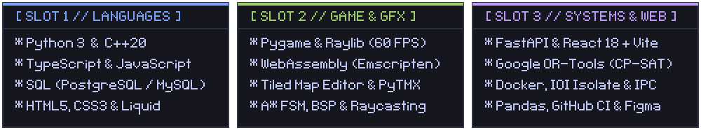
    
  

  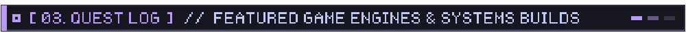
   
  

    <a href="https://github.com/crux-bphc/agent-showdown">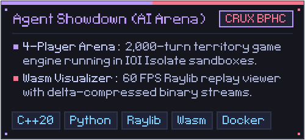</a>
    <a href="https://github.com/BuggedCode410/Dungeon-Crawler">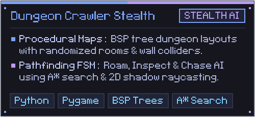</a>
  

  

    <a href="https://github.com/BuggedCode410/stardrew_valley">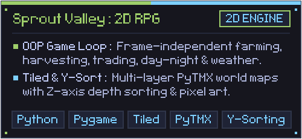</a>
    <a href="https://github.com/madhav336/nosh-theme">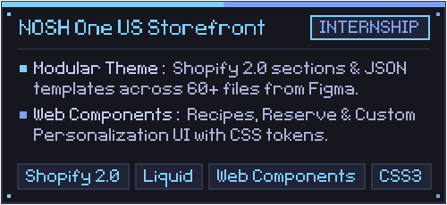</a>
  

  

    <a href="https://github.com/BuggedCode410?tab=repositories">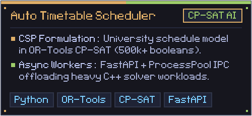</a>
    <a href="https://github.com/BPHC-ACM/nmte2a-web">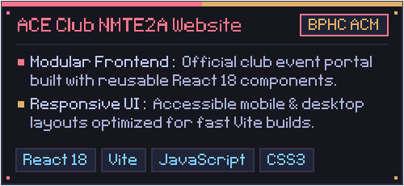</a>
  

  <a href="https://github.com/BuggedCode410/Flappy_bird">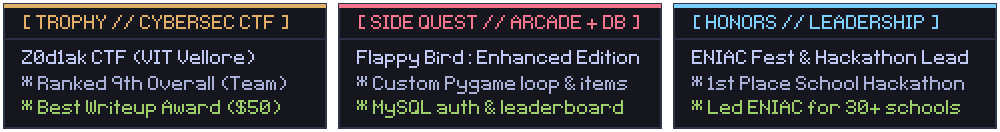</a>

  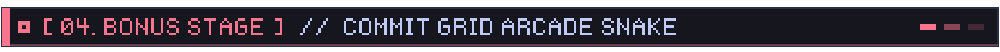
   
  <picture>
    <source media="(prefers-color-scheme: dark)" srcset="https://raw.githubusercontent.com/BuggedCode410/BuggedCode410/output/github-contribution-grid-snake-dark.svg" />
    <source media="(prefers-color-scheme: light)" srcset="https://raw.githubusercontent.com/BuggedCode410/BuggedCode410/output/github-contribution-grid-snake.svg" />
    
  </picture>

