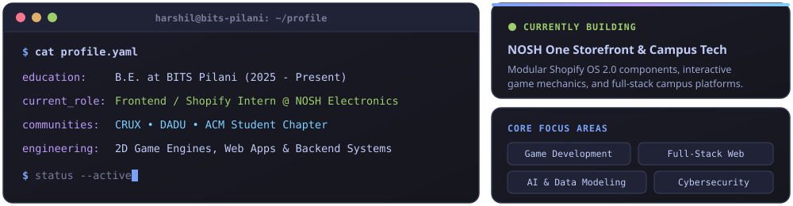
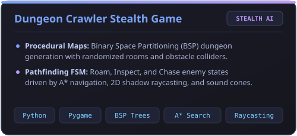
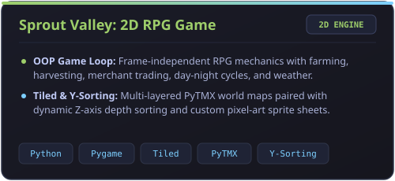
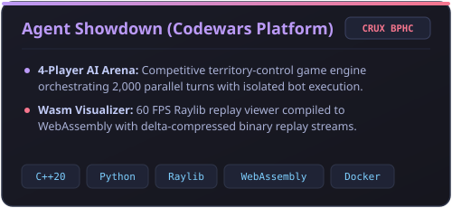
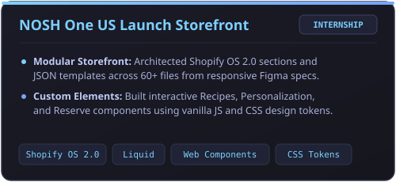
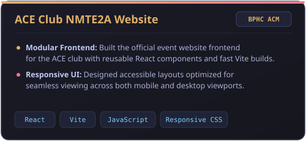
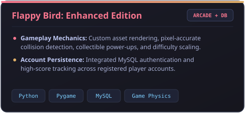

<!-- Self-Hosted Animated SVG Banner -->

<!-- Animated Typing SVG -->

 

<!-- Contact & Quick Badges -->

  
  
  

---

### About Me

  

---

### Tech Stack

**Languages**
 

  

**Frameworks, Libraries & Tools**
 

  

**Game Dev & Specialized Tools**
 

  
  
  
  
  

---

### Featured Projects

  
  
   
  
  
   
  
  

---

### GitHub Metrics & Activity

  <!-- Row 1: Stats & Streak (Matched 49% Widths) -->
  
  

   

  <!-- Row 2: Repos per Language & Commit Activity (Matched 340x200 Aspect Ratios at 48% Width) -->
  
  

   

  <!-- Row 3: Full-Width Contribution Overview Banner -->
  

---

### My Contribution Snake

  <picture>
    <source media="(prefers-color-scheme: dark)" srcset="https://raw.githubusercontent.com/BuggedCode410/BuggedCode410/output/github-contribution-grid-snake-dark.svg" />
    <source media="(prefers-color-scheme: light)" srcset="https://raw.githubusercontent.com/BuggedCode410/BuggedCode410/output/github-contribution-grid-snake.svg" />
    
  </picture>

