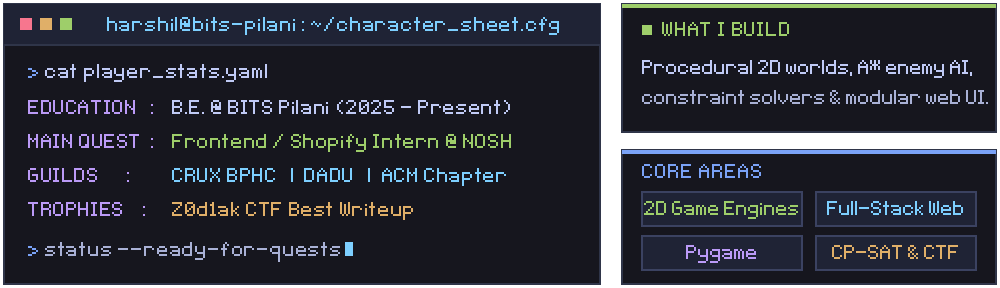
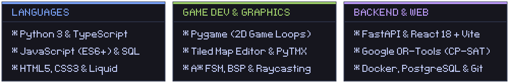
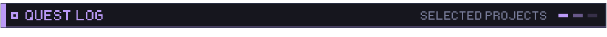
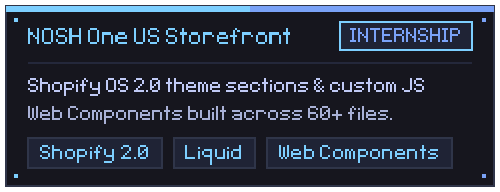
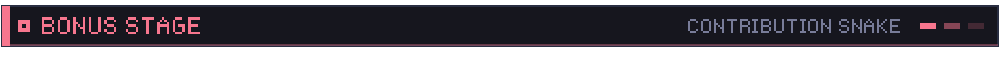
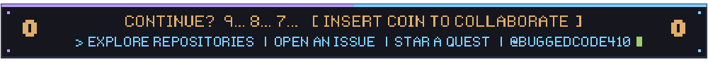

<!-- Generated from profile.toml. Edit that file, not this one. -->

  
  
  

  
  

  
  
    
  

  
  

    
    
  

  

    
    
  

  
  <picture>
    <source media="(prefers-color-scheme: dark)" srcset="https://raw.githubusercontent.com/BuggedCode410/BuggedCode410/output/github-contribution-grid-snake-dark.svg" />
    <source media="(prefers-color-scheme: light)" srcset="https://raw.githubusercontent.com/BuggedCode410/BuggedCode410/output/github-contribution-grid-snake.svg" />
    
  </picture>

  

